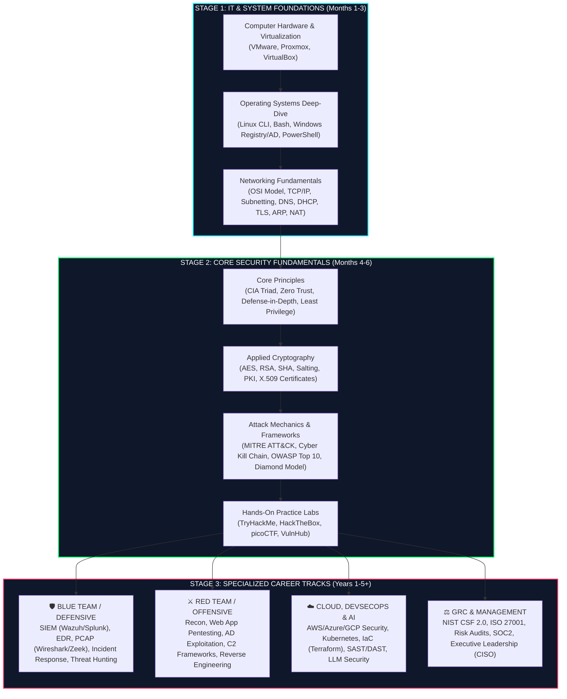

  
    INTERACTIVE CAREER & CERTIFICATION PATHWAYS
  
  <h1 style="margin-top: 0; font-size: 2.1rem; font-weight: 800;">Complete Cybersecurity Roadmap, Roles & Certifications</h1>
  

    A complete step-by-step interactive learning path mapping every cybersecurity role, required technical skill, certification tier, and experience level.
  

## 🗺️ Interactive Visual Learning Roadmap (Zero to Principal)

---

## ✅ Interactive Self-Study Checklist (Click to Expand Each Phase)

???+ info "Phase 1: Fundamental IT, OS & Networking Skills"
    - [x] **Operating Systems**: Master Linux CLI (`grep`, `awk`, `chmod`, `chown`, `systemd`, `iptables`), Windows Active Directory, Group Policy (GPO), and PowerShell.
    - [ ] **Networking**: Understand the 7-layer OSI Model, TCP 3-way handshake, CIDR subnetting, VLANs, DMZs, VPNs, and NAT.
    - [ ] **Essential Protocols & Ports**: SSH (`22`), FTP/SFTP (`21/22`), SMTP (`25`), DNS (`53`), HTTP/HTTPS (`80/443`), SMB (`445`), RDP (`3389`), Kerberos (`88`), LDAP (`389/636`).
    - [ ] **Virtualization**: Build isolated home labs using VirtualBox, VMware ESXi, or Proxmox running Kali Linux and Windows Server.

??? info "Phase 2: Defensive & Offensive Core Competencies"
    - [ ] **Log & Traffic Analysis**: Capture and filter packets in Wireshark; inspect Windows Event Logs (`4624`, `4625`, `4688`), Linux `syslog`, and firewall logs.
    - [ ] **Incident Response Lifecycle**: Master Preparation, Identification, Containment, Eradication, Recovery, and Lessons Learned (PICERL).
    - [ ] **Web & Network Attacks**: Understand SQL Injection, XSS, CSRF, SSRF, Directory Traversal, Pass-the-Hash, ARP Spoofing, and DDoS.
    - [ ] **Scripting & Automation**: Automate security tasks using Python, Bash, PowerShell, or Go.

---

## 💼 Complete Cybersecurity Career Role Matrix

Switch between the tabs below to explore every major role in cybersecurity, including experience required, daily duties, technical skills, and certifications:

=== "🛡️ Blue Team (Defensive & SOC)"

    | Role Title | Experience Level | Core Daily Responsibilities | Must-Have Technical Skills | Recommended Certifications |
    | :--- | :--- | :--- | :--- | :--- |
    | **SOC Analyst (Tier 1 / 2)** | Entry to Mid (0–3 yrs) | Triage SIEM alerts, analyze phishing emails, inspect network PCAPs, isolate infected endpoints. | SIEM (Wazuh/Splunk), Wireshark, EDR triage, Windows/Linux Event Logs, TCP/IP. | CompTIA Security+, BTL1, CompTIA CySA+, GIAC GSEC |
    | **Incident Responder / DFIR** | Mid to Senior (3–6 yrs) | Lead breach containment, conduct memory and disk forensics, reverse engineer malware, eradicate root causes. | Volatility 3, Autopsy, Velociraptor, YARA, Timeline analysis, Ransomware recovery. | GIAC GCIH, GCFA, BTL2, CompTIA CySA+ |
    | **Threat Intelligence Analyst** | Mid (2–5 yrs) | Track APT groups, map adversary TTPs to MITRE ATT&CK, curate IOC feeds, brief executives on dark web threats. | MITRE ATT&CK, Diamond Model, OpenCTI, MISP, YARA, OSINT (SpiderFoot), Python. | GIAC GCTI, CompTIA CySA+ |
    | **Detection Engineer / Threat Hunter** | Senior (4–8 yrs) | Write custom SIEM/Sigma/Suricata detection rules, proactively hunt for stealthy Living-off-the-Land (LOLBins) actors. | Sigma rules, YARA, Suricata, Zeek, KQL/SPL query languages, EDR telemetry engineering. | GIAC GCIA, GCFA, OSDA |

=== "⚔️ Red Team (Offensive & Pentesting)"

    | Role Title | Experience Level | Core Daily Responsibilities | Must-Have Technical Skills | Recommended Certifications |
    | :--- | :--- | :--- | :--- | :--- |
    | **Penetration Tester** | Mid (2–5 yrs) | Conduct authorized network, web application, and wireless penetration tests; write remediation reports. | Nmap, Burp Suite / OWASP ZAP, Metasploit, Active Directory (BloodHound/Impacket), Bash/Python. | OSCP, PNPT, CPTS (HTB), CompTIA PenTest+ |
    | **Red Team Operator** | Senior (4–8+ yrs) | Execute full-scope stealth adversary simulations bypassing EDR/SIEM controls; physical/social engineering. | Custom C2 (Sliver/Cobalt Strike), EDR evasion, C/C#/Rust payload development, Kerberos abuse. | OSEP, CRTO, CREST CRT, GIAC GPEN |
    | **Vulnerability Researcher / Exploit Dev** | Senior/Principal (5–10+ yrs) | Discover 0-day vulnerabilities in OS kernels, browsers, and hardware; write proof-of-concept exploits. | x86/ARM Assembly, Ghidra/IDA Pro, Fuzzing (AFL++), Heap/Stack exploitation, Kernel debugging. | OSED, OSEE, GIAC GXPN |

=== "🏗️ Engineering, Cloud, AppSec & AI"

    | Role Title | Experience Level | Core Daily Responsibilities | Must-Have Technical Skills | Recommended Certifications |
    | :--- | :--- | :--- | :--- | :--- |
    | **Cloud Security Engineer** | Mid to Senior (3–7 yrs) | Secure AWS/Azure/GCP environments, harden IAM roles, lock down Kubernetes clusters, automate CSPM checks. | AWS/Azure/GCP IAM, Terraform, Kubernetes, Docker, Prowler, Falco, CI/CD security. | AWS Security Specialty, AZ-500, CCSP, CKS |
    | **AppSec / DevSecOps Engineer** | Mid to Senior (3–7 yrs) | Integrate SAST/DAST/SCA into CI/CD pipelines, conduct threat modeling and code reviews, manage SBOMs. | Semgrep, Trivy, GitHub Actions, OWASP Top 10, Secure Coding (Python/JS/Go/Java), API Security. | CASE, OSWE, CSSLP, CompTIA SecurityX |
    | **AI Security Engineer** | Mid to Senior (3–7 yrs) | Secure LLM deployments and RAG pipelines against prompt injection, data poisoning, and model extraction. | OWASP LLM Top 10, MITRE ATLAS, Garak, Promptfoo, PyTorch, Vector DB access controls. | CompTIA SecurityX (CAS-005), GIAC GMLE |
    | **OT / ICS Security Engineer** | Mid to Senior (3–8 yrs) | Protect power grids, water plants, and factories; deploy Purdue Model segmentation and passive ICS sensors. | Modbus, DNP3, S7comm, Purdue Model, CISA Malcolm, Zeek ICSNPP, IEC 62443 standard. | GICSP, GRID, ISA/IEC 62443 |
    | **Principal Security Architect** | Principal (7–12+ yrs) | Design enterprise-wide Zero Trust networks, cryptographic PKI infrastructure, and defense-in-depth blueprints. | Zero Trust (NIST 800-207), Enterprise IAM, Cryptography, Multi-cloud architecture, Threat Modeling. | CompTIA SecurityX (CAS-005), CISSP-ISSAP, SABSA |

=== "⚖️ GRC, Privacy & Executive Leadership"

    | Role Title | Experience Level | Core Daily Responsibilities | Must-Have Technical Skills | Recommended Certifications |
    | :--- | :--- | :--- | :--- | :--- |
    | **GRC / Compliance Analyst** | Entry to Mid (1–4 yrs) | Conduct internal security audits, third-party vendor risk assessments, and maintain compliance frameworks. | NIST CSF 2.0, ISO 27001, SOC 2 Type II, GDPR, HIPAA, PCI-DSS, Risk Registers. | CISA, CompTIA Security+, CRISC |
    | **Information Security Manager** | Senior (5–9 yrs) | Manage security budgets, oversee SOC/Engineering teams, run disaster recovery and tabletop exercises. | Security program governance, Policy writing, Incident Management, Vendor management. | CISM, CISSP, CCISO |
    | **Chief Information Security Officer (CISO)** | Executive (10–15+ yrs) | Align cybersecurity strategy with board business objectives, manage regulatory liability, lead crisis response. | Board communication, Enterprise risk quantification (FAIR), M&A security due diligence, Legal/Regulatory. | CISSP, CISM, CCISO |

---

## 🏆 Certification Progression Directory by Vendor

| Tier | CompTIA | ISC2 / ISACA | OffSec / Practical | GIAC (SANS) |
| :--- | :--- | :--- | :--- | :--- |
| **1. Beginner (0–2 yrs)** | A+, Network+, **Security+ (SY0-701)** | ISC2 CC (Certified in Cybersecurity) | eJPT, TryHackMe SAL1, BTL1 | GFACT, GSEC |
| **2. Intermediate (2–5 yrs)** | **CySA+**, **PenTest+**, Cloud+ | SSCP, CISA | **OSCP**, PNPT, CPTS, CRTO | GCIH, GCIA, GPEN, GWAPT |
| **3. Advanced / Expert (5–10+ yrs)** | **SecurityX (CAS-005)** | **CISSP**, **CISM**, CCSP, CRISC | OSEP, OSWE, OSED, OSEE | GCFA, GXPN, GCTI, GSTRT |

---

## ⚡ Deep Dive: The CompTIA SecurityX (CAS-005) Standard

CompTIA officially retired the CASP+ (CAS-004) brand in favor of **CompTIA SecurityX (CAS-005)**, designed to validate senior technical architects and principal engineers.

| Specification | Official Exam Standard |
| :--- | :--- |
| **Exam Code** | CAS-005 |
| **Format** | Up to 90 Performance-Based (PBQ) and Multiple-Choice Questions |
| **Duration** | 165 Minutes |
| **Scoring Model** | Pass / Fail (No scaled numerical score) |
| **Domain Breakdown** | **Security Engineering (31%)**, **Security Architecture (27%)**, **Security Operations (22%)**, **Governance, Risk & Compliance (20%)** |
